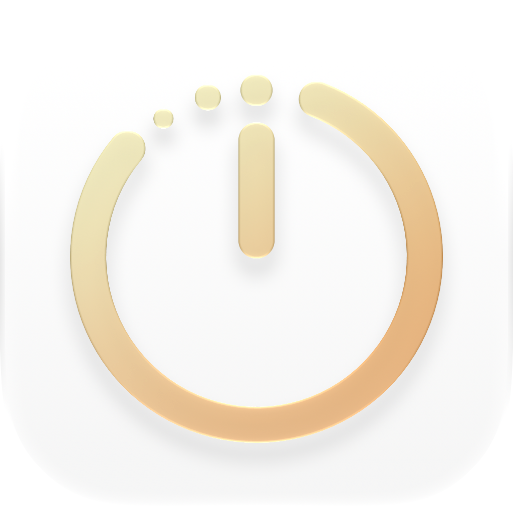
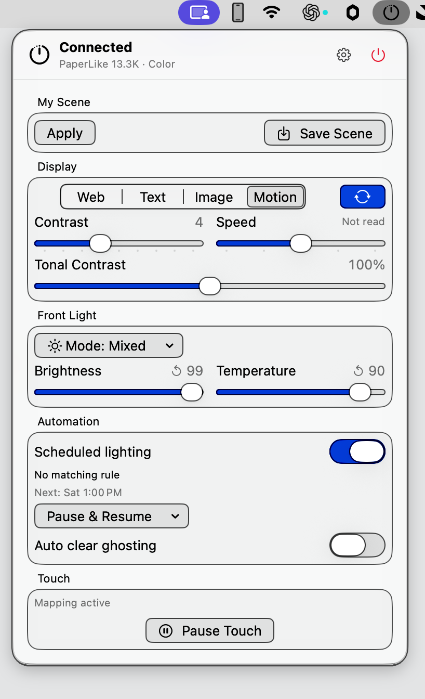

# PaperLike Native

English | [简体中文](README.zh-CN.md)



Control a PaperLike 13.3K e-ink display from your Mac menu bar. Change display modes, adjust the front light, and clear ghosting from a compact panel.

PaperLike Native is an independent, unofficial project for learning and research. Built with SwiftUI, it stores settings locally and requires an Apple Silicon Mac running macOS 15.4 or later.

## Preview

Open the menu bar panel to access display, front light, automation, and touch controls.



## Features

- **Display controls**: Switch between text, web, image, and dynamic modes; adjust contrast and refresh speed; clear ghosting manually or on a schedule.
- **Front light and schedules**: Adjust brightness and color temperature, save custom presets, and schedule changes by day and time.
- **App adaptation**: Apply display rules when switching between apps.
- **Scenes and backup**: Save display settings, import and export configuration, and use the recovery wizard when stored data cannot be read.
- **Touch mapping**: Map touch input to clicks, dragging, and scrolling on supported color models. Automatic mapping and manual calibration are experimental.
- **Display experiments**: Adjust display curves and dithering where supported by the system driver, with an option to restore original values.

## Compatibility

| Item | Status |
| --- | --- |
| Mac | Apple Silicon, macOS 15.4 or later |
| PaperLike 13.3K color | Some controls and device readback verified; long-term operation and full touch experience need more testing |
| PaperLike 13.3K monochrome | Covered by protocol and simulated tests; not yet tested on a physical device |
| Front light | Controls are available when the detected model supports a front light |
| Pinch to zoom | Uses Command + scroll mapping; results depend on the app |
| Intel Mac | Builds and testing are not yet available |

Refresh speed cannot be read back from the device, so the last setting shown is not device confirmation. Video, the control serial port, and touch are separate connections; a connected serial port does not confirm the other two.

Display curves change the mapping of light and dark tones; they are not true saturation or grayscale conversion. This project does not overclock the display or force a higher refresh rate.

## Getting started

The interface supports English and Simplified Chinese and follows the system language by default. Choose a language in Settings → General → System → Language; changes apply immediately and are remembered. Custom scene, rule, and preset names stay as entered.

1. Download the installer from the project's Releases page and move the app to Applications.
2. Connect the display and open the panel from the menu bar. Quit any other client using the same control serial port first.
3. Add scheduled rules under Scenes and application rules under App Adaptation.
4. To use touch, enable it in the Lab and grant Accessibility permission. System display optimizations also require Automation permission.

Default builds are not notarized by Apple. See [distribution and installation](docs/分发与安装.md) for signing and installation details.

## Build from source

Swift 6.2 or later and a compatible macOS SDK are required. Full Xcode is recommended. There are no external Swift package dependencies.

```sh
Tools/test.sh
zsh Tools/test-release-tools.sh
Tools/build-app.sh release
```

The app is created at `.build/PaperLike Native.app`. To create ZIP, DMG, and checksum files:

```sh
Tools/package-app.sh
cd dist
shasum -a 256 -c SHA256SUMS
```

Full Xcode can compile the Icon Composer asset. With only Command Line Tools, the build uses the included compatibility icon. Signing and notarization are optional for local source builds.

## Documentation and contributions

- [Installation and distribution](docs/分发与安装.md)
- [Hardware test checklist](docs/hardware-checklist.md)
- [Serial protocol](docs/protocol/paperlike-13k.md)
- [Contributing](CONTRIBUTING.md)
- [Changelog](CHANGELOG.md)

When reporting a problem, include the app version, macOS version, display model, and steps to reproduce. Distinguish video, serial, and touch connection states. Remove personal information, device serial numbers, and configuration data before sharing diagnostics.

## License

The project code is available under the [MIT License](LICENSE). PaperLike Native is an independent, unofficial client and is not affiliated with the display manufacturer. Brands and trademarks belong to their respective owners. This repository includes sanitized protocol test fixtures derived from device testing, but does not distribute the manufacturer's installer or raw captures.
