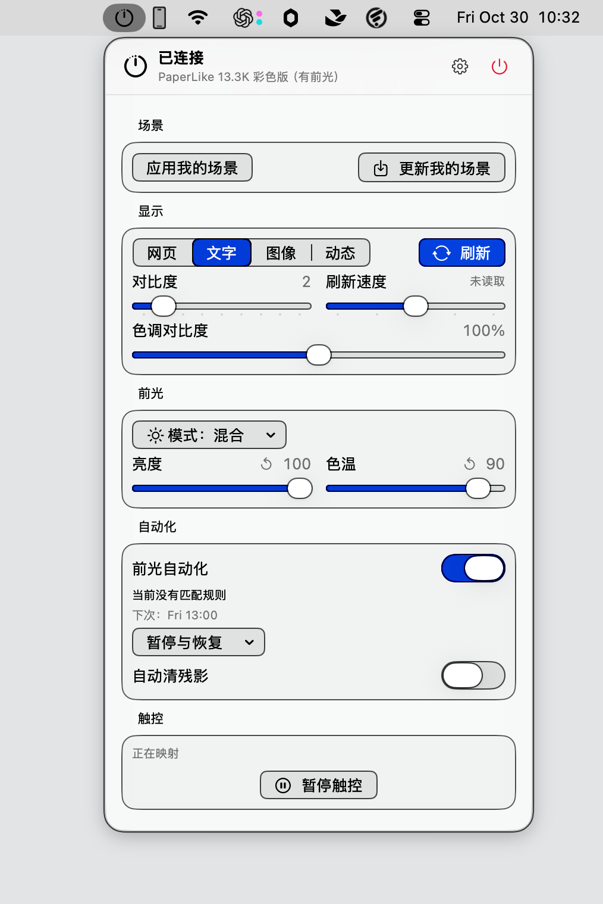

# PaperLike Native

[English](README.md) | 简体中文


在 Mac 菜单栏调节 PaperLike 13.3K 墨水屏。切换显示模式、调整前光、清除残影，常用控制点开即用。

这是一个用于学习和研究的非官方项目，采用 SwiftUI 构建，设置保存在本机。适用于 Apple Silicon Mac，要求 macOS 15.4 或更高版本。

## 界面预览

点击菜单栏图标，即可打开显示、前光、自动化和触控控制。



## 功能

- **显示控制**：切换文字、网页、图像和动态模式，调整对比度与刷新速度，手动或定时清除残影。
- **前光与定时**：调整亮度、色温，保存自己的前光预设，按星期和时段自动切换。
- **应用自适应**：为不同应用设置显示规则，切换应用时自动应用。
- **场景与备份**：保存常用显示设置，导出和导入配置；读取异常时保留原始数据，并提供恢复向导。
- **触控映射**：在支持触控的彩色型号上，将触点映射为点击、拖拽和滚动。支持自动映射与手动校准，仍属实验功能。
- **画面实验**：根据系统驱动能力提供画面曲线和抖动选项，并保留原值恢复入口。

## 支持范围

| 项目 | 状态 |
| --- | --- |
| Mac | Apple Silicon，macOS 15.4+ |
| PaperLike 13.3K 彩色版 | 已验证部分控制与读回操作，长期运行和完整触控体验仍需测试 |
| PaperLike 13.3K 黑白版 | 已覆盖协议与模拟测试，尚未完成黑白实机验证 |
| 前光 | 根据型号识别结果开放，无前光型号不显示相关控制 |
| 捏合缩放 | 使用 Command + 滚轮映射，效果取决于应用 |
| Intel Mac | 暂未提供构建和验证 |

刷新速度无法从设备读回，界面中的“上次设置”不代表设备确认。视频、控制串口和触控是三条独立连接，串口已连接不代表另外两项正常。

画面曲线调整的是亮暗映射，并不等同于真正的饱和度或灰度转换。本项目不提供超频或强制提升刷新率的功能。

## 使用

1. 从项目的 Releases 页面下载安装包，将应用放入“应用程序”文件夹。
2. 连接显示器，点击菜单栏图标打开控制浮层。使用前请退出其他占用同一控制串口的客户端。
3. 在“场景”中添加定时规则，在“应用自适应”中设置应用规则。
4. 如需触控，在“实验室”中启用并授予辅助功能权限。系统显示优化选项另需自动化授权。

默认构建未通过 Apple 公证，安装及签名说明见[分发与安装](docs/分发与安装.md)。

## 从源码构建

需要 Swift 6.2+ 与兼容的 macOS SDK，推荐完整 Xcode。没有外部 Swift 包依赖。

```sh
Tools/test.sh
zsh Tools/test-release-tools.sh
Tools/build-app.sh release
```

应用位于 `.build/PaperLike Native.app`。生成 ZIP、DMG 及校验文件：

```sh
Tools/package-app.sh
cd dist
shasum -a 256 -c SHA256SUMS
```

完整 Xcode 可编译 Icon Composer 资源。仅安装 Command Line Tools 时，构建使用仓库中的兼容图标。正式签名和公证为可选发布步骤，不是源码构建的前提。

## 文档与贡献

- [安装与分发](docs/分发与安装.md)
- [设备测试清单](docs/hardware-checklist.md)
- [串口协议](docs/protocol/paperlike-13k.md)
- [贡献指南](CONTRIBUTING.md)
- [更新记录](CHANGELOG.md)

报告问题时，请提供应用版本、macOS 版本、显示器型号和复现步骤，区分视频、串口和触控的状态。分享诊断前请移除个人信息、设备序列号及配置内容。

作者：[X · @teno_liu](https://x.com/teno_liu)

## 参考与许可

项目代码采用 [MIT 许可证](LICENSE)。PaperLike Native 是独立的非官方客户端，与显示器厂商无隶属关系；品牌和商标归各自权利人所有。仓库包含由设备测试整理并脱敏的协议测试夹具，但不分发原厂安装包或原始采集。
